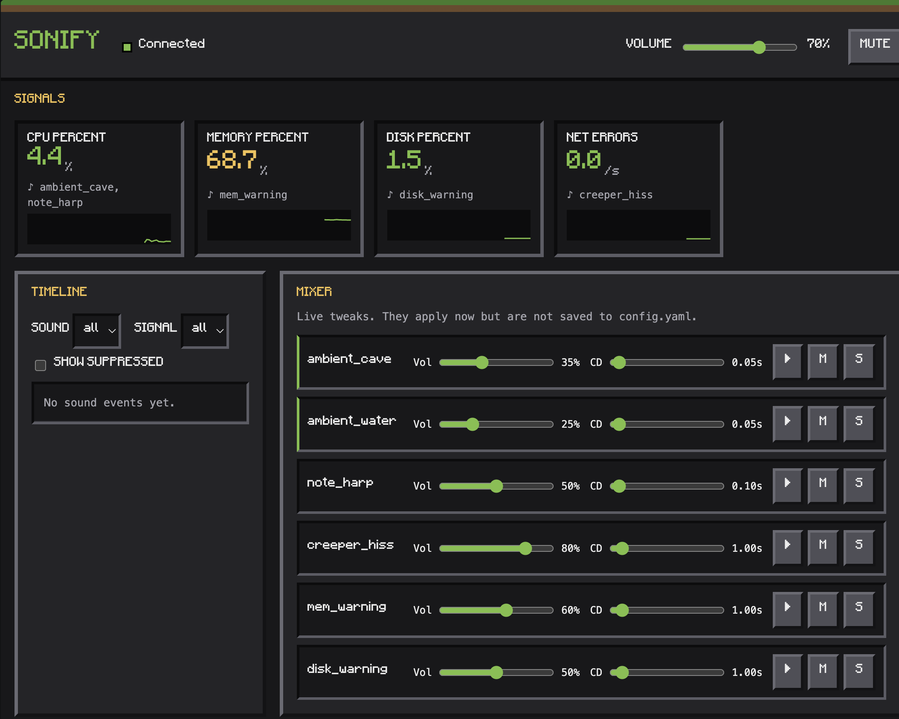

# sonify

Hear the health of your machines. `sonify` is a small daemon that turns system
metrics into ambient Minecraft sound effects: a healthy machine sounds like a
quiet cave, and problems stand out.

It runs standalone on macOS. No Minecraft client or server needs to be running;
it only reads sound files from your own Minecraft install.


<!-- TODO: add a screenshot or GIF at docs/dashboard.png -->

## Setup

Requires Python 3.9+ and Minecraft Java Edition launched at least once (so the
launcher has downloaded its assets).

```bash
python3 -m venv .venv && source .venv/bin/activate
pip install -e .
sonify setup        # extract and convert the sounds named in config.yaml
sonify run          # start the daemon
```

`sonify setup` finds `~/Library/Application Support/minecraft/assets/`, resolves
each sound through `indexes/*.json` and the hashed `objects/` folder, and writes
44.1 kHz stereo WAVs to `./sounds/`. **No Mojang assets are bundled or
committed**; `sounds/` is git-ignored. Use `--minecraft-dir` if your install is
elsewhere, and `--force` to re-extract.

## Commands

| Command | What it does |
| --- | --- |
| `sonify setup` | Extract and prepare sounds from your Minecraft install |
| `sonify run [--config F] [--volume 0-1] [--mute] [--ui] [--port N]` | Start the daemon |
| `sonify test <sound>` | Play one configured sound (`--pitch N` for pitched sounds) |
| `sonify list` | Show sounds, whether they are installed, and the current mappings |

## Sound mapping

Everything is driven by `config.yaml`; change the soundscape without touching
code. Two layers:

- **Ambient bed** (continuous, encodes state): looping sounds whose gain follows a
  metric. Cave ambience gets louder as CPU climbs; a quiet water bed is always on.
- **Event sounds** (discrete, mark moments): rule-based and rate-limited.

| Signal | Sound |
| --- | --- |
| `cpu_percent` | Note-block harp. Pitch follows load and tempo speeds up, but only above 25% so an idle machine is silent. Cave bed gets louder with load. |
| `memory_percent` | Bell above 85%, repeated every 30s while it stays high. |
| `disk_percent` | Anvil above 90%. |
| `net_errors` | Creeper hiss when errors + drops exceed 1/s. |

Rules (`signals.<name>.events`):

- `when: {above|below, hysteresis}`: becomes active at the threshold and only
  releases after moving `hysteresis` back, so a value hovering at the line does
  not flap. While active it fires, then repeats every `cooldown_s`.
- `mode: pitch_tempo`: rhythmic notes; `pitch` maps the value range onto the
  scale and `interval_s` maps it onto the gap between notes.
- Pitched sounds are always quantized to `pitched.scale` (pentatonic by default),
  so they never sound random.

The engine adds its own safeguards: per-sound cooldowns, a global events-per-second
cap, polyphony limit (oldest voice is stolen), and ducking. A sound that fires
often is turned down so rare ones stand out.

## Dashboard

```bash
sonify run --ui            # http://localhost:8765
sonify run --ui --port 9000
```

A local web UI with live signal tiles and sparklines, an event timeline with
filters, a mixer (master/per-sound volume, mute, solo, live cooldowns) and a
mapping editor that validates and saves `config.yaml` (atomically) and hot-reloads
it. It binds to `127.0.0.1` only, rejects other `Host`/`Origin` headers, loads
nothing from the network and sends no telemetry.

The frontend is plain HTML and ES modules with no build step. For the pixel font,
see `src/sonify/ui/static/fonts/README.md` (without it, a system monospace is used).

The UI only subscribes to the daemon's event bus (`metric`, `sound`, `state`,
`config` events over `/ws`) and calls the engine's public methods; it duplicates
no logic. Other endpoints: `GET/PUT /config`, `POST /preview/{sound}`,
`POST /mute`, `PUT /volume`, `PUT /mixer/{sound}`, `PUT /solo`.

## Layout

```
src/sonify/
  sources/   pluggable collectors (psutil today; Docker/log tail later)
  mapper/    config + samples -> sound actions (scale.py holds quantization)
  engine/    pygame mixer: polyphony, cooldowns, ducking, pan, pitch
  assets/    locate, resolve and convert Minecraft sounds
  ui/        FastAPI dashboard
  bus.py     thread-safe event bus used by the dashboard
```

## Development

```bash
pip install -e '.[dev]'
pytest
```

The audio layer is mocked in tests (`tests/fakes.py`), so no sound hardware or
Minecraft install is needed.

## Open TODOs

- `mapper/scale.py::quantize_to_scale`: until implemented, pitched notes stay on
  the root note and a warning is logged.
- `config.py::validate_mapping`: cross-field rules for the mapping editor; only
  structural checks run today.
