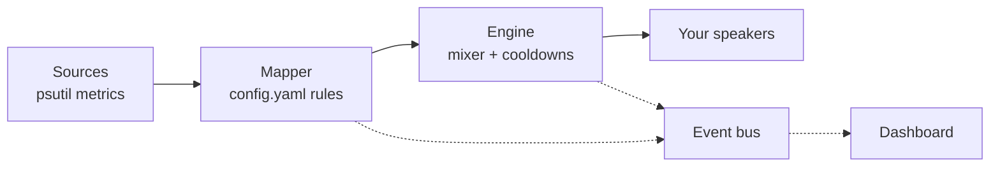

# sonify

Hear the health of your computer.

`sonify` turns system metrics (CPU, memory, disk, network errors) into ambient Minecraft sounds. A calm machine sounds like a quiet cave. When something goes wrong, you *hear* it, no dashboard-staring required.


## Table of Contents
- [How it works](#how-it-works)
- [Installation](#installation)
- [Getting your sounds](#getting-your-sounds)
- [Running it](#running-it)
- [What does it sound like?](#what-does-it-sound-like)
- [Editing the soundscape](#editing-the-soundscape)
- [Dashboard](#dashboard)
- [Project layout](#project-layout)
- [Development](#development)
- [Future improvements](#future-improvements)

## How it works
Four small pieces, each doing one job:



- **Sources** read your machine every second or so
- **Mapper** looks at `config.yaml` and decides *"this should make a sound"*
- **Engine** decides whether it *may* (cooldowns, polyphony, ducking) and plays it
- **Assets** finds the sounds in *your own* Minecraft install and converts them

There are two layers of sound:
- **Ambient bed:** continuous loops whose volume follows a metric (the cave gets louder as CPU climbs)
- **Event sounds:** short sounds that mark a moment (a bell when memory runs high)

## Installation
> [!IMPORTANT]
> You need **Python 3.9+**, **macOS**, and **Minecraft Java Edition** launched at least once (so the launcher has downloaded its sound files).

> [!NOTE]
> No Minecraft client needs to be *running*, and no Mojang files are included in this repo. Sonify reads the sounds from your own install. That is what `sonify setup` is for.

Clone the repository and install it in a virtual environment:
```bash
git clone <this-repo-url> sonify
cd sonify
python3 -m venv .venv && source .venv/bin/activate
pip install -e .
```

Or from PyPI:
```bash
pip install minecraft-sonify
```
Then create your starter config:
```bash
sonify init
```

The command is called `sonify` either way.

## Getting your sounds
```bash
sonify setup
```
That's it! It will:
1. Find your Minecraft assets folder (`~/Library/Application Support/minecraft/assets`)
2. Look up each sound named in `config.yaml` through Minecraft's asset index
3. Convert them to WAV files in `./sounds/` (which is git-ignored)

> [!TIP]
> Minecraft isn't in the default place? Launchers like Lunar Client keep their own copy. Point sonify at it:
> ```bash
> sonify setup --minecraft-dir ~/.lunarclient/shared/assets
> ```
> or set `SONIFY_MINECRAFT_ASSETS` once and forget about it. Use `--force` to re-extract everything.

## Running it
```bash
sonify run
```
Press `Ctrl-C` to stop.

| Command | What it does |
| --- | --- |
| `sonify init` | Write a starter `config.yaml` you can edit |
| `sonify setup` | Extract and prepare sounds from your Minecraft install |
| `sonify run` | Start listening to your machine |
| `sonify test <sound>` | Play one sound so you know it works (`--pitch N` for pitched sounds) |
| `sonify list` | Show your sounds, whether they're installed, and the current mappings |

Handy flags for `sonify run`:

| Flag | What it does |
| --- | --- |
| `--config FILE` | Use a different config file |
| `--volume 0-1` | Set the master volume |
| `--mute` | Start silent (still shows the dashboard) |
| `--ui` | Open the web dashboard |
| `--port N` | Dashboard port (default `8765`) |

## What does it sound like?
| Signal | Sound |
| --- | --- |
| `cpu_percent` | Note-block harp. The pitch climbs and the tempo speeds up with load, but only above 25%, so an idle machine stays silent. The cave ambience gets louder too. |
| `memory_percent` | A bell above 85%, repeating every 30 seconds while it stays high |
| `disk_percent` | An anvil above 90% |
| `net_errors` | A creeper hiss when errors and drops go above 1 per second |

Harp notes are always snapped to a pentatonic scale, so even a stressed machine sounds musical instead of random.

Sonify also protects your ears:
- every sound has a **cooldown**
- there is a global **events-per-second cap**
- the **oldest** sound gets cut when too many play at once
- sounds that fire often get **ducked** so the rare ones stand out

## Editing the soundscape
Everything lives in `config.yaml`. No code changes needed.

<details>
  <summary><b>A tiny example</b></summary>

  ```yaml
  sounds:
    note_harp: { key: block.note_block.harp, kind: pitched, volume: 0.5 }
    mem_warning: { key: block.note_block.bell, kind: oneshot, volume: 0.6 }

  signals:
    memory_percent:
      source: psutil.memory
      events:
        - sound: mem_warning
          when: { above: 85, hysteresis: 5 }
          cooldown_s: 30
  ```
</details>

A rule can do three things:
- `when: {above | below, hysteresis}` turns on at the threshold and only turns off after the value moves `hysteresis` back. Hovering around the line won't make it flap. While on, it fires and repeats every `cooldown_s`.
- `mode: pitch_tempo` plays rhythmic notes. `pitch` maps the value onto the scale, and `interval_s` maps it onto the gap between notes.
- `ambient` makes a looping sound follow a value, with a `gain` min and max.

> [!NOTE]
> Don't want to edit YAML by hand? The dashboard has a mapping editor that checks your changes and reloads them live.

## Dashboard
```bash
sonify run --ui
```
Then open [http://localhost:8765](http://localhost:8765).

- **Live tiles** for each signal, with sparklines
- **Timeline** of every sound that played (or was skipped, and why), with filters
- **Mixer** with master and per-sound volume, mute, solo and live cooldowns
- **Mapping editor** that validates, saves `config.yaml` and hot-reloads it

> [!WARNING]
> If port `8765` is already taken, sonify will tell you. Pick another with `--port 9000`.

It's private by design: it only listens on `127.0.0.1`, rejects requests from other hosts or origins, loads nothing from the internet, and sends no telemetry. The page is plain HTML and ES modules with no build step, and the pixel font is served locally.

<details>
  <summary><b>For the curious: what the dashboard talks to</b></summary>

  The dashboard only listens to the daemon's event bus (`metric`, `sound`, `state` and `config` events over `/ws`) and calls the engine's public methods. It doesn't duplicate any logic.

  | Endpoint | What it does |
  | --- | --- |
  | `GET /config`, `PUT /config` | Read, or validate and atomically save the config |
  | `POST /preview/{sound}` | Play a sound |
  | `POST /mute`, `PUT /volume` | Master mute and volume |
  | `PUT /mixer/{sound}`, `PUT /solo` | Per-sound settings and solo |
</details>

## Project layout
```
src/sonify/
  sources/   metric collectors (psutil today, more later)
  mapper/    config + samples -> sound actions
  engine/    mixer: polyphony, cooldowns, ducking, pan, pitch
  assets/    find, resolve and convert Minecraft sounds
  ui/        FastAPI dashboard and its frontend
  bus.py     tiny thread-safe event bus
```

## Development
```bash
pip install -e '.[dev]'
pytest
```
Audio is mocked in the tests, so you don't need speakers or a Minecraft install.

## Future improvements
> [!TIP]
> - [x] Ambient bed + event sounds
> - [x] Local web dashboard with mixer and mapping editor
> - [ ] `mapper/scale.py::quantize_to_scale`: until it lands, pitched notes stay on the root note and a warning is logged
> - [ ] `config.py::validate_mapping`: cross-field rules for the mapping editor (only structural checks run today)
> - [x] `sonify init` writes a starter `config.yaml`
> - [ ] Docker events and log-tail sources
> - [ ] Per-host stereo panning
> - [ ] Menu bar app
